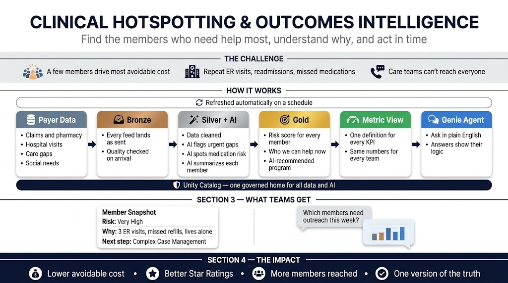

# Clinical Hotspotting & Outcomes Intelligence on Databricks

**Find the members who need help most, understand why, and act in time.**

An end-to-end, deploy-anywhere Databricks demo for a Medicare Advantage health plan: synthetic payer data flows through a
Lakeflow Spark Declarative Pipeline (bronze → silver with AI enrichment → gold), into a governed **metric view**, and out
to a fully configured **Genie agent** that care teams can ask questions in plain English. Everything is packaged as a
**Databricks Asset Bundle**, so one `deploy` + one `run` stands it up in any workspace.

All data is **synthetic and PHI-free**.



---

## What gets deployed

| Resource | Name | What it does |
|---|---|---|
| Job | `Clinical Hotspotting End-to-End Pipeline` | Orchestrates the 4 steps below (serverless, a job cluster, or your cluster; see [Choosing compute](#choosing-compute)) |
| Pipeline (SDP; serverless or classic) | `clinical-hotspotting-sdp-<schema>` | 8 bronze → 8 silver (5 AI-enriched) → 8 gold tables |
| Metric views | `mv_clinical_hotspotting` (one row per member), `mv_encounter_utilization` (one row per encounter) | 14 member KPIs + 9 encounter KPIs, reconciled with the source tables on every run |
| Genie agent | `Clinical Hotspotting & Outcomes Intelligence` | 9 tables, instructions, example SQL, joins, snippets, synonyms, entity matching, 10 sample questions, 12 benchmarks |

Job tasks:

```
generate_synthetic_data ──► run_sdp_pipeline ──┬──► create_metric_view
                                               └──► create_genie_agent  (creates/updates the agent, then asks it a test question)
```

| Layer | Tables | AI functions |
|---|---|---|
| Source (`01`) | `members` (5,000), `providers`, `encounters`, `medical_claims`, `pharmacy_claims`, `care_gaps`, `care_interventions`, `sdoh` | — |
| Bronze (`02`) | `bz_*` — raw + audit columns + data-quality expectations | — |
| Silver (`03`) | `silver_*` — cleansed | `ai_summarize`, `ai_classify`, `ai_analyze_sentiment` on encounters, pharmacy, care gaps, interventions, SDoH |
| Gold (`04`) | `gold_member_hotspots`, `gold_cohort_summary`, `gold_geographic_hotspots`, `gold_intervention_outcomes`, `gold_provider_outcomes`, `gold_transplant_outcomes`, `gold_clinical_narratives`, `gold_intervention_recs` | `ai_summarize`, `ai_classify` for member narratives and recommended programs |

---

## Prerequisites

1. **Databricks CLI** v0.250+ (`databricks --version`), authenticated to the target workspace:
   ```bash
   databricks auth login --host https://<your-workspace>.cloud.databricks.com --profile <PROFILE>
   ```
2. A workspace with **Unity Catalog**, **AI Functions** (Foundation Model APIs) and **Genie**. Serverless jobs and pipelines
   are recommended but **not required**. Without them, use the `classic` or `interactive` target (see
   [Choosing compute](#choosing-compute)).
3. An existing **catalog** where you have `USE CATALOG` and `CREATE SCHEMA`. The bundle creates the schema.
4. A **serverless SQL warehouse** for the Genie agent (required for every target). If you don't specify one, the first
   serverless warehouse you can see is used. A pro or classic warehouse is rejected with a clear error.
5. Optional: [`jq`](https://jqlang.org/), used by the verification and cleanup commands to look up the Genie space ID.

---

## Quick start

```bash
git clone https://github.com/bigdatavik/ClinicalHotspotting.git
cd ClinicalHotspotting
databricks bundle deploy -t dev --profile <PROFILE> --var="catalog=<CATALOG>"
databricks bundle run clinical_hotspotting_e2e -t dev --profile <PROFILE> --var="catalog=<CATALOG>"
```

That's all you need: `deploy` creates the job, pipeline and notebooks, and `run` builds the data, the metric view **and the
Genie agent**. The step-by-step guide below explains each step and how to check it.

---

## Step-by-step deployment guide

### Step 1 — Get the code

```bash
git clone https://github.com/bigdatavik/ClinicalHotspotting.git
cd ClinicalHotspotting
```

### Step 2 — Authenticate the Databricks CLI to your workspace

```bash
databricks auth login --host https://<your-workspace>.cloud.databricks.com --profile <PROFILE>
databricks current-user me --profile <PROFILE>      # should print your user
```

Every command below uses `--profile <PROFILE>`. If you already have a profile, run `databricks auth profiles` to list it.

### Step 3 — Choose a catalog (and optionally a SQL warehouse)

```bash
databricks catalogs list   --profile <PROFILE>   # pick an existing catalog you can create schemas in
databricks warehouses list --profile <PROFILE>   # optional: copy a warehouse ID for the Genie agent
```

- **Catalog** (required): the bundle creates the schema `clinical_hotspotting` in it. You need `USE CATALOG` and
  `CREATE SCHEMA`.
- **Warehouse** (optional): if you don't set one, the Genie task uses the first serverless warehouse you can see.

The examples below pass these with `--var`. See [Configuration](#configuration) for other ways to set them once.

### Step 4 — Validate the bundle

```bash
databricks bundle validate -t dev --profile <PROFILE> --var="catalog=<CATALOG>"
```

Expect `Validation OK!`.

### Step 5 — Deploy the bundle

```bash
databricks bundle deploy -t dev --profile <PROFILE> --var="catalog=<CATALOG>"
# optionally add: --var="warehouse_id=<WAREHOUSE_ID>"
```

This uploads the notebooks and creates two resources:

- Job: **`[dev <you>] Clinical Hotspotting End-to-End Pipeline`**
- Pipeline: **`[dev <you>] clinical-hotspotting-sdp-clinical_hotspotting`**

The **Genie agent is not created yet**. It is created in Step 6, after its tables exist (see
[why](#why-the-genie-agent-is-created-by-a-job-task-not-a-bundle-resource)). To print the job and pipeline URLs, run
`databricks bundle summary -t dev --profile <PROFILE> --var="catalog=<CATALOG>"`.

### Step 6 — Run the end-to-end job (this also creates the Genie agent)

```bash
databricks bundle run clinical_hotspotting_e2e -t dev --profile <PROFILE> --var="catalog=<CATALOG>"
```

The command prints a run URL and waits until the job finishes. The job runs four tasks (on serverless for `dev`):

| # | Task | Notebook | Creates | Time (tested) |
|---|---|---|---|---|
| 1 | `generate_synthetic_data` | `01_generate_synthetic_data` | Schema + 8 source tables | ~1 min |
| 2 | `run_sdp_pipeline` | `02`–`04` (pipeline) | 8 bronze, 8 silver (AI-enriched), 8 gold tables | ~25 min |
| 3 | `create_metric_view` | `05_create_metric_view` | `mv_clinical_hotspotting` + `mv_encounter_utilization`, then reconciles them with the source tables | <1 min |
| 4 | `create_genie_agent` | `09_genie_config` | **Genie agent** (create or update) + smoke-test question | ~1 min |

Most of the pipeline time goes to the AI functions, which make about 75k LLM calls (mostly `ai_classify` on ~45k
pharmacy claims).

### Step 7 — Verify the deployment

```bash
# Tables: expect 5000 members and ~3,200 actionable hotspots
databricks experimental aitools tools query \
  "SELECT COUNT(*) AS members, SUM(CAST(is_actionable_hotspot AS INT)) AS actionable
   FROM <CATALOG>.clinical_hotspotting.gold_member_hotspots" --profile <PROFILE>

# Genie agent: find its ID
databricks genie list-spaces --profile <PROFILE> -o json \
  | jq -r '.spaces[] | select(.title | test("Clinical Hotspotting")) | "\(.space_id)  \(.title)"'

# Ask the agent a question
databricks genie start-conversation <SPACE_ID> "How many actionable hotspot members are there in each market?" --profile <PROFILE>
```

In the workspace UI:

- **Jobs & Pipelines** → the job run shows 4 green tasks. Open `create_genie_agent` to see the agent's URL, space ID, and
  its answer to the test question.
- **Genie** (sidebar) → **Clinical Hotspotting & Outcomes Intelligence**. Try the sample questions.
- **Catalog** → `<CATALOG>.clinical_hotspotting` → open any gold table → **Lineage**.

### Step 8 — Run the demo

Open `06_demo` (walkthrough) and `07_demo_talk_track` (presenter script) from the bundle folder in your workspace,
`/Workspace/Users/<you>/.bundle/clinical-hotspotting/dev/files/src`. Set the `catalog` / `schema` widgets at the top to
your values. See [Running the demo](#running-the-demo).

---

## Configuration

Everything that changes per workspace is a bundle variable in [`databricks.yml`](databricks.yml):

| Variable | Default | Description |
|---|---|---|
| `catalog` | *(required)* | Existing catalog to write to |
| `schema` | `clinical_hotspotting` | Schema created inside the catalog |
| `warehouse_id` | `""` (auto-pick) | **Serverless** SQL warehouse used by the Genie agent |
| `genie_title` | `Clinical Hotspotting & Outcomes Intelligence` | Agent title. An agent with this exact title is **updated**, not duplicated |
| `genie_smoke_test` | `"true"` | Ask the agent a test question and fail the job if it can't answer |
| `node_type_id` | `""` | `classic` / `interactive` only: node type for the job cluster and pipeline cluster (cloud-specific) |
| `spark_version` | `17.3.x-scala2.13` | `classic` only: runtime for the job cluster (the metric views use YAML spec 1.1, which needs DBR 17.2+) |
| `num_workers` | `2` | `classic` / `interactive`: workers for the job cluster and pipeline cluster |
| `existing_cluster_id` | `""` | `interactive` only: all-purpose cluster for the notebook tasks |

Three ways to set them:

```bash
# a) on the command line
databricks bundle deploy -t dev --profile <PROFILE> --var="catalog=main" --var="warehouse_id=abc123"

# b) environment variables
export BUNDLE_VAR_catalog=main
export BUNDLE_VAR_warehouse_id=abc123

# c) a per-target overrides file (git-ignored): .databricks/bundle/dev/variable-overrides.json
{ "catalog": "main", "warehouse_id": "abc123" }
```

Or add your own target to `databricks.yml`:

```yaml
targets:
  my_workspace:
    mode: development
    workspace:
      host: https://<your-workspace>.cloud.databricks.com
    variables:
      catalog: my_catalog
      warehouse_id: abc123
```

### Targets

| Target | Mode | Notes |
|---|---|---|
| `dev` (default) | development | Serverless. Job/pipeline names are prefixed `[dev <you>]`; files go to `~/.bundle/clinical-hotspotting/dev` |
| `prod` | production | Serverless. Files go to `~/.bundle/clinical-hotspotting/prod`; you get CAN_MANAGE, the `users` group gets CAN_VIEW |
| `classic` | development | No serverless: job cluster + classic pipeline cluster. Needs `node_type_id` |
| `interactive` | development | No serverless: existing all-purpose cluster + classic pipeline cluster. Needs `existing_cluster_id` and `node_type_id` |

### Choosing compute

**There is no automatic fallback.** A bundle fixes its compute at deploy time, and Databricks doesn't switch a task to a
cluster when serverless is unavailable: the task just fails. Pick the target that matches your workspace:

| Your workspace has… | Use | Notebook tasks (`01`, `05`, `09`) | Pipeline (`02`–`04`) | Genie agent |
|---|---|---|---|---|
| Serverless jobs + pipelines | `dev` / `prod` | Serverless | Serverless | Serverless SQL warehouse |
| No serverless jobs/pipelines | `classic` | One shared **job cluster** (starts with the run, stops after) | Classic pipeline cluster | Serverless SQL warehouse |
| No serverless, and you want an existing cluster | `interactive` | Your **all-purpose cluster** | Classic pipeline cluster | Serverless SQL warehouse |

- SDP pipelines can never run on an all-purpose cluster. They always start their own cluster, even in `interactive`.
- Clusters use Unity Catalog in dedicated (single-user) access mode with DBR 17.3 LTS (17.2+ is required for the metric views' YAML spec 1.1). For `interactive`, your
  cluster must be UC-enabled and on 17.2+.
- Serverless SQL warehouses are a separate setting from serverless jobs and pipelines, so a workspace without serverless
  jobs can still have one.

```bash
# Classic: job cluster (node types: AWS i3.xlarge / m5d.xlarge, Azure Standard_D4ds_v5, GCP n2-highmem-4)
databricks bundle deploy -t classic --profile <PROFILE> --var="catalog=<CATALOG>" --var="node_type_id=<NODE_TYPE>"
databricks bundle run clinical_hotspotting_e2e -t classic --profile <PROFILE> --var="catalog=<CATALOG>" --var="node_type_id=<NODE_TYPE>"

# Interactive: existing all-purpose cluster for the notebook tasks
databricks bundle deploy -t interactive --profile <PROFILE> --var="catalog=<CATALOG>" \
  --var="existing_cluster_id=<CLUSTER_ID>" --var="node_type_id=<NODE_TYPE>"
databricks bundle run clinical_hotspotting_e2e -t interactive --profile <PROFILE> --var="catalog=<CATALOG>" \
  --var="existing_cluster_id=<CLUSTER_ID>" --var="node_type_id=<NODE_TYPE>"
```

Use the same target in every command (deploy, run, destroy). Each target is a separate deployment with its own job and
pipeline.

**Tested:** `classic` ran end to end on Azure (`Standard_D4ds_v5`, 2 workers, DBR 17.3 LTS): data generation ~12 min
(including job cluster start-up), pipeline ~45 min, metric views and Genie ~1 min each. Expect about 1 hour, versus ~30 min
on serverless. The results matched the serverless run exactly (5,000 members, 3,225 actionable).

---

## Running the demo

After the job succeeds, open the deployed notebooks in the workspace under
`.bundle/clinical-hotspotting/<target>/files/src`:

| Notebook | Purpose |
|---|---|
| `06_demo` | Customer-facing walkthrough: Genie → metric view → gold → silver AI → bronze → sources |
| `07_demo_talk_track` | 30–40 min read-along script with discovery questions and value framing |

Set the `catalog` / `schema` widgets at the top of each notebook to match your deployment.

---

## Project layout

```
databricks.yml                         bundle config, variables, targets
resources/
  clinical_hotspotting.pipeline.yml    SDP pipeline (serverless)
  clinical_hotspotting_e2e.job.yml     orchestration job
src/
  00_config.py                         shared parameters (reference)
  01_generate_synthetic_data.py        8 synthetic source tables
  02_sdp_bronze.py                     SDP bronze + expectations
  03_sdp_silver_ai.py                  SDP silver + AI Functions
  04_sdp_gold.py                       SDP gold + AI narratives/recommendations
  05_create_metric_view.py             governed metric views (member + encounter grain) + reconciliation check
  06_demo.py                           demo walkthrough
  07_demo_talk_track.py                presenter talk track
  09_genie_config.py                   Genie agent as code (create/update + smoke test)
scripts/destroy.sh                     one-command teardown (bundle, Genie agent, schema) with confirmation + verify
docs/architecture.png
```

### Why the Genie agent is created by a job task, not a bundle resource

The Genie API rejects a space whose tables don't exist yet. On a fresh workspace, the gold tables appear only after
the pipeline runs, so a `genie_spaces` bundle resource would fail on the first `deploy`. Instead, `09_genie_config.py`
runs after the pipeline. It checks every example and benchmark query against the data, then creates or updates the
agent by title. The full definition lives in that notebook.

What this means in practice:

| Action | Job, pipeline, notebooks | Genie agent |
|---|---|---|
| `bundle deploy` | Created / updated | Not touched |
| `bundle run clinical_hotspotting_e2e` | Run | **Created**, or **updated** if an agent with the same `genie_title` exists |
| `bundle destroy` | Deleted (the pipeline's bronze/silver/gold tables too) | **Deleted**, because the agent is created inside the bundle folder (`parent_path`), which destroy removes |
| Edit Genie instructions / SQL / benchmarks | — | Edit `src/09_genie_config.py`, then deploy and run the Genie task |

---

## Re-running and updating

**Refresh everything.** Re-run the job. Source tables are overwritten (same seed, so the data is identical), the
pipeline recomputes, and the Genie agent is updated in place:

```bash
databricks bundle run clinical_hotspotting_e2e -t dev --profile <PROFILE> --var="catalog=<CATALOG>"
```

**Change only the Genie agent** (instructions, example SQL, synonyms, benchmarks). Edit `src/09_genie_config.py`, then
deploy and run just that task:

```bash
databricks bundle deploy -t dev --profile <PROFILE> --var="catalog=<CATALOG>"
databricks bundle run clinical_hotspotting_e2e -t dev --profile <PROFILE> --var="catalog=<CATALOG>" --only create_genie_agent
```

**Change pipeline code** (`02`–`04`). Deploy, then run the pipeline task and everything after it:

```bash
databricks bundle deploy -t dev --profile <PROFILE> --var="catalog=<CATALOG>"
databricks bundle run clinical_hotspotting_e2e -t dev --profile <PROFILE> --var="catalog=<CATALOG>" --only run_sdp_pipeline+
```

**Second copy in the same workspace.** A copy is a separate deployment, so it needs a **different target**, plus a
different `schema` and `genie_title`. Changing only `--var` values on the same target redeploys the same job and
pipeline instead of creating new ones.

```bash
databricks bundle deploy -t prod --profile <PROFILE> --var="catalog=<CATALOG>" --var="schema=clinical_hotspotting_v2" --var="genie_title=Clinical Hotspotting v2"
```

The pipeline name includes the schema (`clinical-hotspotting-sdp-<schema>`), because pipeline names must be unique
in a workspace.

## Clean up

### One command (recommended)

[`scripts/destroy.sh`](scripts/destroy.sh) deletes everything this project created. It shows a plan, asks you to type
the schema name to confirm, then checks that nothing is left:

```bash
# Default deployment (target dev, schema clinical_hotspotting)
scripts/destroy.sh -p <PROFILE> -c <CATALOG>

# Custom target / schema / Genie title: use the same values you deployed with
scripts/destroy.sh -p <PROFILE> -c <CATALOG> -t classic -s clinical_hotspotting_v2 -g "Clinical Hotspotting v2"

# Extra bundle variables go after --  (e.g. for the interactive target)
scripts/destroy.sh -p <PROFILE> -c <CATALOG> -t interactive -- --var=existing_cluster_id=<CLUSTER_ID>

# Non-interactive (CI): skip the confirmation prompt
scripts/destroy.sh -p <PROFILE> -c <CATALOG> -y
```

| Step | What it deletes |
|---|---|
| 1. `bundle destroy` | Job, pipeline (with its bronze/silver/gold tables), deployed files, and the Genie agent in the bundle folder |
| 2. Genie | Any agent still left with the exact `genie_title` (for example, created outside the bundle folder) |
| 3. Schema | `<CATALOG>.<SCHEMA>` with the 8 source tables and 2 metric views (`databricks schemas delete --force`) |
| 4. Verify | Fails (exit 1) if the schema, a Genie agent or the pipeline still exists |

Requires `jq`. Tested end to end on Azure, including the abort path for a wrong confirmation.

### Manual commands

Use the same target and variables you deployed with (for example `-t classic --var="node_type_id=..."`).

```bash
# 1. Delete the job, the pipeline (with its bronze/silver/gold tables), the deployed files,
#    and the Genie agent (it lives in the bundle folder)
databricks bundle destroy -t dev --profile <PROFILE> --var="catalog=<CATALOG>"

# 2. Drop the rest of the data: the schema, the 8 source tables and the 2 metric views
databricks schemas delete <CATALOG>.clinical_hotspotting --force --profile <PROFILE>

# 3. Check that no Genie agent is left (prints nothing when clean)
databricks genie list-spaces --profile <PROFILE> -o json \
  | jq -r '.spaces[]? | select(.title | test("Clinical Hotspotting")) | "\(.space_id)  \(.title)"'
# If one is listed (for example, created before this behavior or with a custom parent_path):
databricks genie trash-space <SPACE_ID> --profile <PROFILE>
```

## Troubleshooting

| Symptom | Fix |
|---|---|
| `catalog` variable has no value | Pass `--var="catalog=<CATALOG>"`, or use one of the other options above |
| `PERMISSION_DENIED` creating the schema | Grant `USE CATALOG` and `CREATE SCHEMA` on the catalog, or pick another one |
| Pipeline fails on `ai_*` functions | AI Functions / Foundation Model APIs are not enabled in this workspace or region |
| `create_genie_agent` fails with "No serverless SQL warehouse found" | Create a serverless SQL warehouse (or ask an admin to enable serverless SQL) and pass `--var="warehouse_id=<ID>"` |
| `create_genie_agent` fails with "Warehouse … is not serverless" | Genie in this project requires a serverless warehouse. Pass a serverless `warehouse_id` |
| Tasks fail with a serverless-not-enabled error | The workspace has no serverless jobs or pipelines. Use `-t classic` or `-t interactive` |
| `classic` deploy fails on `node_type_id` | Pass a node type valid for your cloud: `databricks clusters list-node-types --profile <PROFILE>` |
| `pipeline name ... is already used` (409) | Another deployment uses the same schema. Use a different `schema` (it's part of the pipeline name) |
| Genie smoke test times out | The warehouse was cold. Re-run the task, or set `genie_smoke_test=false` |

## Metric view design

Each metric view has a single grain, so no measure double-counts:

- **`mv_clinical_hotspotting`**: one row per member, from `gold_member_hotspots`. Use it for "how many / what share
  of members" (actionable rate, per-1,000 rates, cost per member, adherence, SDoH).
- **`mv_encounter_utilization`**: one row per encounter, from `silver_encounters` with many-to-one joins to providers
  and members. Use it for utilization by encounter type, diagnosis, provider, specialty or month.

An earlier version joined member rows to encounters in one view. That repeated each member once per encounter and
inflated member KPIs (for example, the actionable rate read ~0.80 instead of ~0.65). The last cell of
`05_create_metric_view` compares both views with the source tables and fails the job if they ever disagree.
